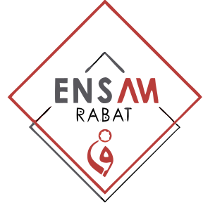
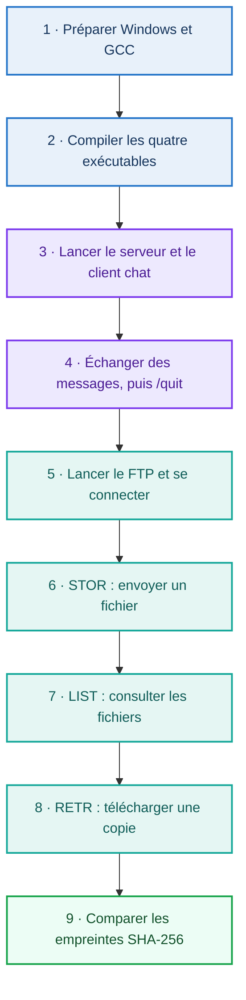
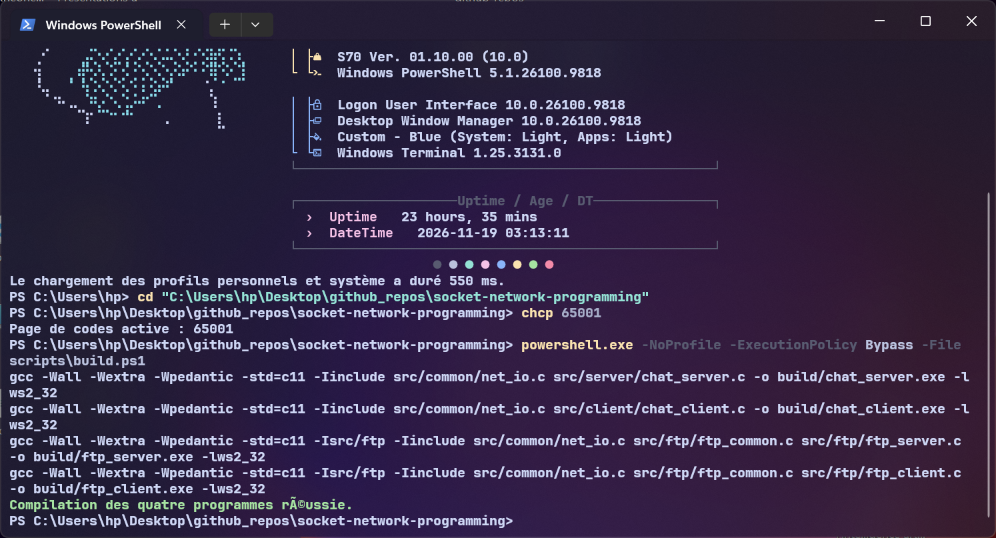
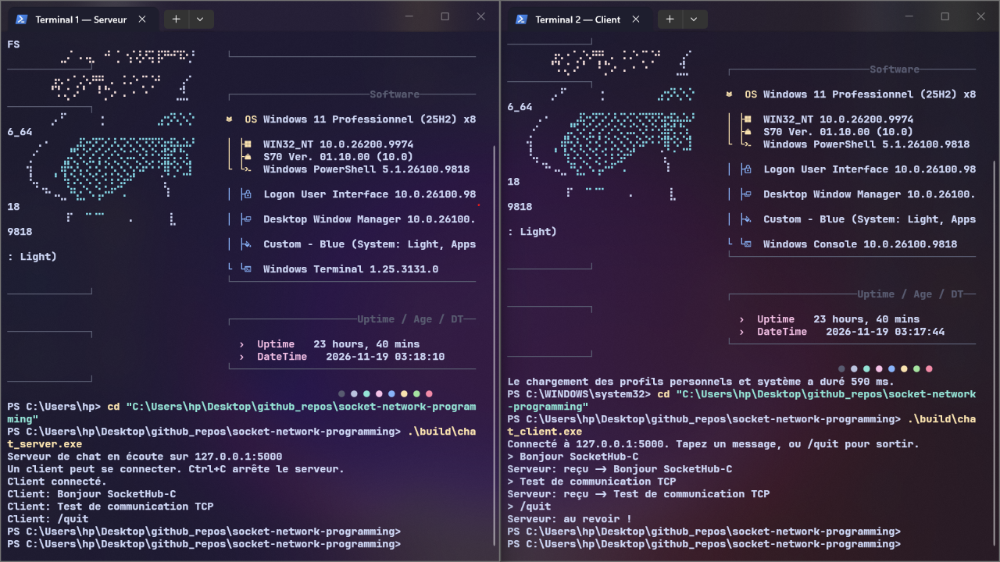
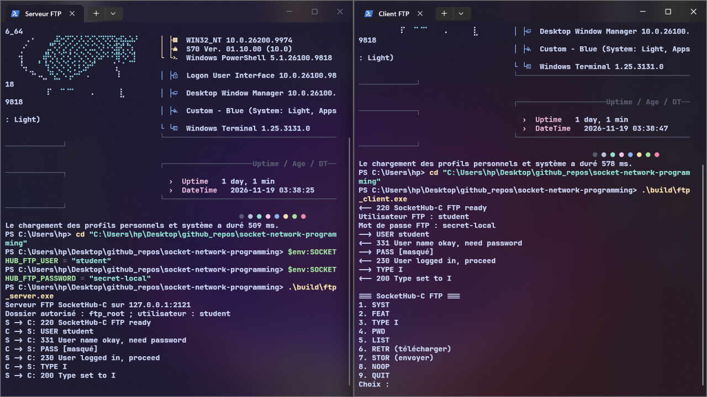
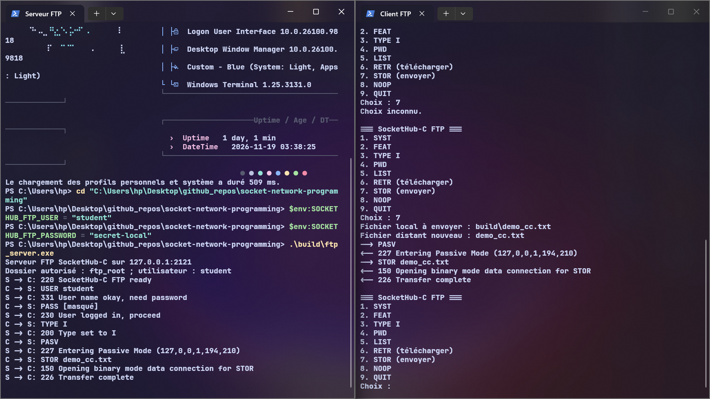
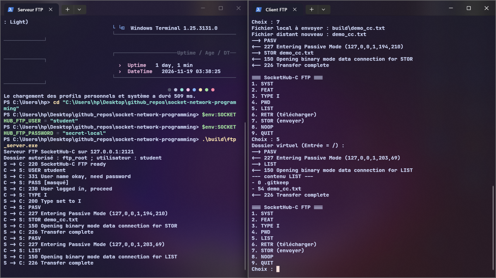
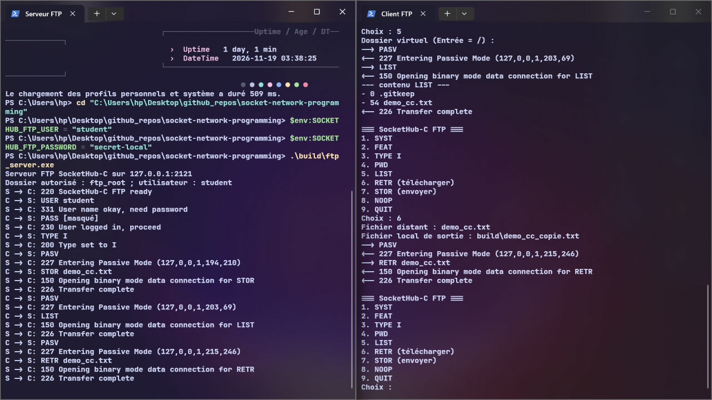
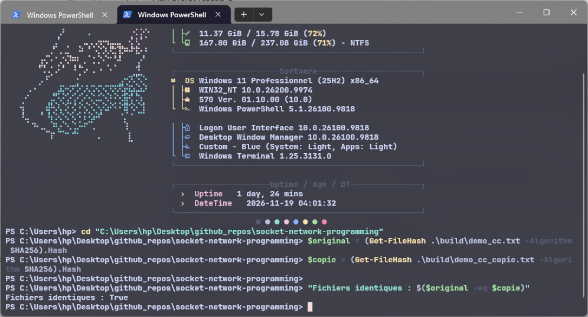
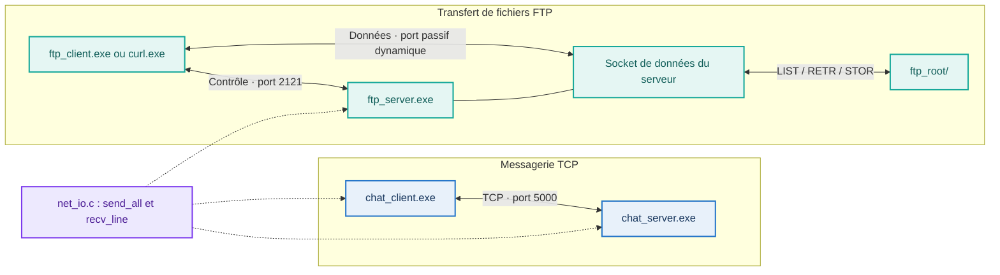

<div align="center">

&nbsp;&nbsp;&nbsp;&nbsp;


# SocketHub-C

**Programmation réseau native en C · Chat TCP & transfert de fichiers FTP**

Un projet universitaire sous Windows pour comprendre les sockets, le cadrage des messages et le transfert de fichiers sur deux connexions TCP.


<br><br>


[Présentation](#présentation) · [Parcours](#parcours-de-démonstration) · [Démarrage rapide](#démarrage-rapide) · [Captures](#démonstration-en-images) · [Architecture](#architecture) · [Tests](#tests-et-validation)

[Consulter les diapositives en PDF](presentation/output/SocketHub-C_Presentation.pdf) · [Ouvrir le dossier PowerPoint et PDF](presentation/output/)

</div>

## Présentation

SocketHub-C réunit **quatre exécutables C**, sans framework : un serveur et un client de messagerie TCP, ainsi qu'un serveur et un client FTP pédagogique. Les deux services écoutent uniquement sur **`127.0.0.1`**, pour des démonstrations sur la même machine.

- **Chat TCP — port `5000` :** messages avec accusé de réception, commande `/quit` et détection des déconnexions. Le serveur traite une seule session puis se termine.
- **FTP — port de contrôle `2121` :** authentification, listing, upload et téléchargement. Le serveur reste actif et traite les sessions successivement, une à la fois.
- **Entrées/sorties partagées :** `send_all` gère les envois partiels ; `recv_line` reconstitue les lignes lorsque TCP fragmente ou regroupe les messages.

> [!NOTE]
> Le chat illustre un échange client/serveur avec accusés de réception. Le FTP ajoute une connexion de contrôle, une connexion de données et la gestion des fichiers sous Windows.

## Parcours de démonstration

Du code source à la vérification du fichier téléchargé, voici les étapes à suivre. Le chat et le FTP peuvent aussi être exécutés indépendamment.



**À retenir :** le port `5000` transporte les messages du chat. Le port `2121` transporte les commandes FTP ; les fichiers passent par une autre connexion TCP, ouverte en mode passif.

## Fonctionnalités

### Messagerie TCP

- Connexion client/serveur IPv4 avec WinSock2.
- Échanges de plusieurs messages dans une session, avec réponse du serveur.
- Messages délimités par une fin de ligne et tampon de réception de 4096 octets.
- Vérification des erreurs réseau et libération des ressources avec `closesocket` et `WSACleanup`.

### Mini-service FTP

- Commandes `USER`, `PASS`, `SYST`, `FEAT`, `TYPE I`, `PWD`, `PASV`, `EPSV`, `LIST`, `RETR`, `STOR`, `NOOP` et `QUIT`.
- Connexion de contrôle distincte de la connexion de données passive, sur un port local attribué dynamiquement.
- Transferts texte et binaires par buffers de **64 KiB**, avec gestion des envois partiels.
- Compte configuré par variables d'environnement ; mot de passe masqué dans les journaux du serveur.
- Accès limité à `ftp_root/` : rejet des chemins absolus, de `..` et des reparse points contrôlés par le serveur.
- Upload dans un fichier temporaire puis déplacement vers la destination, sans écraser un fichier existant.
- Client C avec menu interactif et interopérabilité testée avec `curl.exe`.

## Technologies

<p align="center">
  
</p>

- **C11** : logique des clients, des serveurs et des protocoles.
- **WinSock2 / `ws2_32`** : sockets TCP, connexions et échanges réseau.
- **API Win32** : fichiers, chemins Unicode, répertoires et contrôles des attributs.
- **GCC · MSYS2 UCRT64 / MinGW-w64** : compilation native Windows.
- **PowerShell** : automatisation de la compilation et des validations ; **CMD** : lancement possible des exécutables et scripts PowerShell.
- **curl.exe** : validation du service FTP avec un client externe.

## Démarrage rapide

### 1. Préparer l'environnement

Prévoir Windows, Git, GCC via MSYS2 UCRT64 ou MinGW-w64, et deux terminaux. Ajouter le dossier contenant `gcc.exe` au `PATH` du terminal utilisé. `curl.exe` est nécessaire pour la validation FTP complète.

Depuis PowerShell :

```powershell
git clone https://github.com/saadshr/socket-network-programming.git
Set-Location socket-network-programming
gcc --version
curl.exe --version
```

### 2. Compiler les quatre programmes

La commande suivante fonctionne depuis **PowerShell ou CMD**, à la racine du dépôt :

```powershell
powershell.exe -NoProfile -ExecutionPolicy Bypass -File scripts\build.ps1
```

Les exécutables sont générés dans `build/`. Le script active `-Wall -Wextra -Wpedantic -std=c11` et lie `ws2_32`.

<details>
<summary><strong>Compilation manuelle depuis MSYS2</strong></summary>

```bash
mkdir -p build
gcc -Wall -Wextra -Wpedantic -std=c11 -Iinclude src/common/net_io.c src/server/chat_server.c -o build/chat_server.exe -lws2_32
gcc -Wall -Wextra -Wpedantic -std=c11 -Iinclude src/common/net_io.c src/client/chat_client.c -o build/chat_client.exe -lws2_32
gcc -Wall -Wextra -Wpedantic -std=c11 -Isrc/ftp -Iinclude src/common/net_io.c src/ftp/ftp_common.c src/ftp/ftp_server.c -o build/ftp_server.exe -lws2_32
gcc -Wall -Wextra -Wpedantic -std=c11 -Isrc/ftp -Iinclude src/common/net_io.c src/ftp/ftp_common.c src/ftp/ftp_client.c -o build/ftp_client.exe -lws2_32
```

</details>

### 3. Essayer le chat TCP

Ouvrir deux terminaux PowerShell **à la racine du dépôt**.

Terminal 1 — serveur :

```powershell
.\build\chat_server.exe
```

Terminal 2 — client :

```powershell
.\build\chat_client.exe
```

Saisir plusieurs messages, puis `/quit`. Exemple d'échange :

```text
Client : premier message
Serveur: reçu -> premier message
Client : deuxième message
Serveur: reçu -> deuxième message
Client : /quit
Serveur: au revoir !
```

Relancer le serveur de chat avant une nouvelle session.

### 4. Essayer le FTP

Terminal 1 — définir un compte de démonstration local, puis démarrer le serveur :

```powershell
$env:SOCKETHUB_FTP_USER = "student"
$env:SOCKETHUB_FTP_PASSWORD = "choisir-un-secret-local"
.\build\ftp_server.exe
```

`SOCKETHUB_FTP_PASSWORD` doit être défini avant le lancement. L'utilisateur vaut `student` si `SOCKETHUB_FTP_USER` est absent ou vide. Choisir un mot de passe non vide réservé à cette démonstration.

Terminal 2 — lancer le client :

```powershell
.\build\ftp_client.exe
```

Saisir les mêmes identifiants, puis utiliser le menu : **`5`** pour `LIST`, **`7`** pour `STOR`, **`6`** pour `RETR`, **`9`** pour `QUIT`. Les noms distants sont relatifs à `ftp_root/` ; une destination d'upload doit être nouvelle.

Pour vérifier le listing avec curl, saisir le mot de passe à l'invite :

```powershell
curl.exe --ftp-pasv --user student ftp://127.0.0.1:2121/
```

Fermer d'abord le client C : le serveur FTP traite une seule session à la fois. Utiliser `Ctrl+C` dans le terminal du serveur pour l'arrêter.

## Démonstration en images

Ces captures proviennent du dossier [`presentation/assets/screenshots/`](presentation/assets/screenshots/). Elles montrent les commandes et les échanges observés pendant la démonstration ; ouvrir une image permet d'en lire les détails.

### 1. Compilation des quatre exécutables

Le script `scripts/build.ps1` compile les clients et serveurs chat et FTP avec GCC, puis affiche la confirmation de compilation. Les options C11 et la bibliothèque `ws2_32` sont visibles dans le terminal.



### 2. Chat TCP : connexion, messages et fermeture

Le serveur écoute sur `127.0.0.1:5000`. Le client envoie deux messages, reçoit leurs accusés de réception, puis termine la session avec `/quit`.



### 3. FTP : authentification et transferts

La démonstration suit les opérations `USER` / `PASS`, `STOR`, `LIST` et `RETR`. Les codes `230` et `226` signalent respectivement une connexion authentifiée et la fin d'un transfert.

<details>
<summary><strong>Connexion FTP — authentification et menu du client</strong></summary>

L'échange affiche `220` à l'accueil, `331` après `USER`, puis `230` après l'authentification. Le client sélectionne ensuite le mode binaire avec `TYPE I`.



Les identifiants visibles dans cette capture sont ceux de la démonstration locale.

</details>

<details>
<summary><strong>STOR — envoi d'un fichier vers le serveur</strong></summary>

Le fichier local `build/demo_cc.txt` est envoyé vers `demo_cc.txt` dans la racine FTP. Après `PASV`, les réponses `150` puis `226` accompagnent le transfert.



</details>

<details>
<summary><strong>LIST — consultation des fichiers disponibles</strong></summary>

Le listing contient `demo_cc.txt`, précédemment envoyé. Une nouvelle connexion de données passive sert à transmettre la liste.



</details>

<details>
<summary><strong>RETR — téléchargement d'une copie locale</strong></summary>

Le client récupère `demo_cc.txt` et écrit la copie dans `build/demo_cc_copie.txt`. Le serveur confirme la fin de l'opération avec `226`.



</details>

### 4. Vérification de l'intégrité avec SHA-256

PowerShell calcule les empreintes du fichier original et de sa copie téléchargée. La comparaison affiche **`Fichiers identiques : True`** pour cette démonstration.



> [!TIP]
> Pour reproduire ce contrôle après votre transfert, comparer les fichiers avec `Get-FileHash -Algorithm SHA256`. Cette vérification est effectuée côté test ou terminal ; elle ne fait pas partie du protocole FTP implémenté.

## Architecture

### Deux services et une couche réseau partagée



Toutes les connexions réseau du schéma restent sur **`127.0.0.1`**. `ftp_client.exe` utilise aussi la couche partagée ; `curl.exe` est un client externe indépendant.

### Repères pour comprendre les sockets

- **Initialiser :** `WSAStartup` prépare WinSock2 ; `socket` crée la socket TCP.
- **Côté serveur :** `bind` fixe l'adresse, `listen` met en écoute, `accept` accepte la connexion.
- **Côté client :** `connect` rejoint l'adresse et le port du serveur.
- **Échanger :** `send` et `recv` transportent les octets ; `send_all` et `recv_line` gèrent les envois partiels et le cadrage.
- **Fermer :** `closesocket` libère les sockets, puis `WSACleanup` termine l'utilisation de WinSock2.

### Organisation du dépôt

```text
socket-network-programming/
├── include/net_io.h            # Interface réseau partagée
├── src/
│   ├── common/net_io.c         # send_all et recv_line
│   ├── server/chat_server.c    # Serveur de messagerie TCP
│   ├── client/chat_client.c    # Client de messagerie TCP
│   └── ftp/
│       ├── ftp_common.c        # Connexions passives et transferts
│       ├── ftp_common.h
│       ├── ftp_server.c        # Authentification et accès aux fichiers
│       └── ftp_client.c        # Menu FTP interactif
├── scripts/
│   ├── build.ps1
│   └── test.ps1
├── tests/
│   ├── ftp_validation.ps1
│   └── validation.md
├── ftp_root/.gitkeep           # Racine des fichiers servis
├── presentation/
│   ├── assets/                # Illustration, logos et captures réelles
│   └── output/                # Présentation PowerPoint et version PDF
└── docs/
    ├── architecture.md
    ├── guide-binome.md
    └── demo-orale.md
```

## Tests et validation

Arrêter les serveurs de démonstration pour libérer les ports `5000` et `2121`, puis exécuter depuis la racine :

```powershell
powershell.exe -NoProfile -ExecutionPolicy Bypass -File scripts\test.ps1
```

Ce script recompile les quatre programmes, vérifie un échange chat avec deux messages et `/quit`, puis lance la validation FTP : authentification, listing passif, transferts texte et binaires, comparaison SHA-256, refus de chemins interdits et d'écrasement, client C et curl. Le test des reparse points nécessite que Windows autorise la création d'une junction.

Les résultats historiques du **18 novembre 2026**, dont les scénarios TCP supplémentaires de fragmentation, regroupement et déconnexion, sont conservés dans [le compte rendu de validation](tests/validation.md).

## Limites et points de vigilance

- **Usage pédagogique local :** le chat n'a pas d'authentification ; le FTP utilise un compte configuré. Aucun des deux services ne chiffre les échanges ; FTP transmet les identifiants en clair.
- **Concurrence :** le chat se termine après une session ; le FTP accepte plusieurs sessions successives, sans traitement simultané.
- **Taille des messages :** le lecteur réseau partagé utilise 4096 octets, y compris pour les commandes FTP. Dans le chat, le préfixe ajouté par le serveur peut faire dépasser le tampon de réponse du client pour un message proche de cette limite.
- **Blocages possibles :** les échanges utilisent des sockets bloquantes, sans délai maximal général de session ou de transfert ; l'attente d'une connexion de données passive est limitée à 10 secondes.
- **Transferts :** le contrôle SHA-256 appartient aux tests ; le protocole ne vérifie pas lui-même une taille attendue ou une empreinte avant de valider un upload.
- **Protection des chemins :** les contrôles existants ne constituent pas une isolation système contre un processus local qui modifierait les fichiers ou répertoires pendant un transfert.
- **Périmètre :** Windows uniquement ; pas de FTPS/TLS, mode FTP actif, comptes multiples, chat multi-client, UDP ni application de temps.

## Documentation

- [Présentation en PDF — 9 diapositives](presentation/output/SocketHub-C_Presentation.pdf) — support de présentation du projet.
- [Présentation PowerPoint et PDF](presentation/output/) — les deux formats dans le même dossier.
- [Captures de compilation et de démonstration](presentation/assets/screenshots/) — les sept captures utilisées dans ce README.
- [Architecture détaillée](docs/architecture.md) — organisation et échanges réseau.
- [Guide pédagogique du binôme](docs/guide-binome.md) — explications du code et du protocole.
- [Démonstration et présentation orale](docs/demo-orale.md) — déroulé de la démonstration.
- [Compte rendu de validation](tests/validation.md) — scénarios exécutés et preuves textuelles.

---

<div align="center">

**SocketHub-C** · Projet universitaire de programmation réseau

**C11 · WinSock2 · TCP · FTP passif · Windows**

[](https://github.com/saadshr)

</div>
