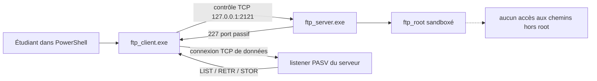
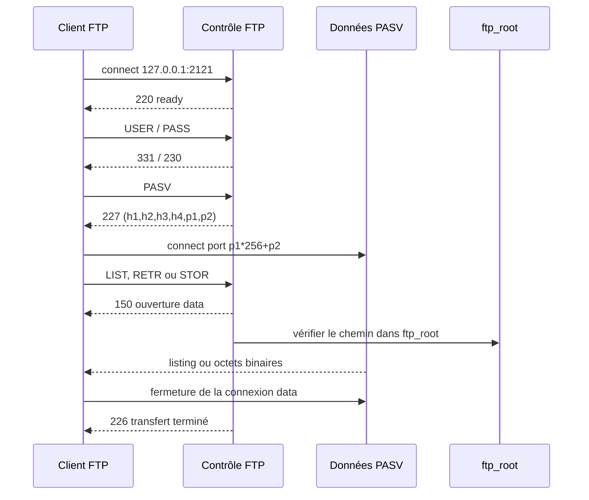

# Architecture de SocketHub-C

## Deux services indépendants

Le projet contient deux vertical slices C natifs qui ne partagent pas leur port :

- le chat écoute sur `127.0.0.1:5000` et utilise `src/common/net_io.c` ;
- le FTP écoute sur `127.0.0.1:2121`, utilise `src/ftp/` et limite ses fichiers à `ftp_root/`.

Le chat existant n'est pas modifié par le FTP.

## Rôle exact des fichiers FTP

| Fichier | Responsabilité |
|---|---|
| `src/ftp/ftp_common.h` | Constantes de ports/tampons et prototypes partagés par le client et le serveur. |
| `src/ftp/ftp_common.c` | Encadrement des lignes de contrôle, parsing PASV, connexion de données et transferts binaires par blocs. |
| `src/ftp/ftp_server.c` | Serveur FTP, authentification, commandes, socket PASV, LIST et sandbox Windows. |
| `src/ftp/ftp_client.c` | Client terminal avec menu, lecture des réponses multi-lignes, PASV, STOR et RETR. |
| `ftp_root/.gitkeep` | Dossier racine autorisé du serveur ; les fichiers de démonstration restent locaux et ignorés. |

Les fichiers chat sont décrits dans l'architecture TCP existante : `include/net_io.h`, `src/common/net_io.c`, `src/client/chat_client.c` et `src/server/chat_server.c`.

## Flux FTP



## Cycle réseau d'une opération



## Cycle WinSock2

Pour le contrôle comme pour les données, le programme appelle `WSAStartup`, crée un socket TCP avec `socket(AF_INET, SOCK_STREAM, IPPROTO_TCP)`, vérifie les retours de `bind`, `listen`, `accept`, `connect`, `send` et `recv`, puis ferme chaque socket avec `closesocket` avant `WSACleanup`.

Le serveur crée d'abord le socket de contrôle avec `bind`/`listen`. `accept` retourne une socket dédiée au client. Lors de `PASV`, un second socket est lié au port 0 ; Windows choisit un port libre. `getsockname` permet de communiquer ce port au client. Le client ouvre alors une seconde connexion avec `connect`.

## Sécurité des fichiers

Le serveur convertit le chemin virtuel UTF-8 en chemin Windows relatif, refuse les racines, les lettres de lecteur, `..` et les composants invalides. Chaque composant existant est contrôlé avec `GetFileAttributesW`; les `FILE_ATTRIBUTE_REPARSE_POINT` sont refusés. `STOR` écrit d'abord dans un fichier temporaire dans le dossier parent, puis `MoveFileExW` valide le fichier sans remplacer une destination existante.

## Compilation FTP

```bash
gcc -Wall -Wextra -Wpedantic -std=c11 -Isrc/ftp -Iinclude src/common/net_io.c src/ftp/ftp_common.c src/ftp/ftp_server.c -o build/ftp_server.exe -lws2_32
gcc -Wall -Wextra -Wpedantic -std=c11 -Isrc/ftp -Iinclude src/common/net_io.c src/ftp/ftp_common.c src/ftp/ftp_client.c -o build/ftp_client.exe -lws2_32
```
