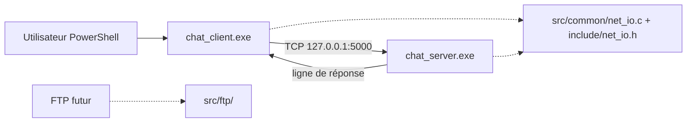
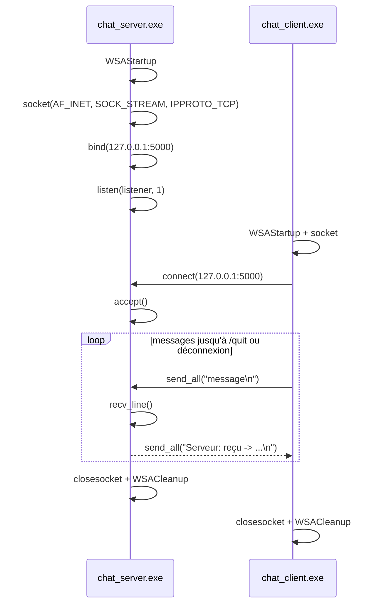

# Architecture de SocketHub-C

## Périmètre

Cette version contient un vertical slice complet mais minimal du chat TCP local. Deux processus indépendants sont lancés : `chat_server.exe` écoute sur `127.0.0.1:5000`, tandis que `chat_client.exe` s'y connecte et échange des lignes.

Le futur FTP sera isolé dans `src/ftp/`. Il n'existe encore aucun serveur FTP, client FTP, commande FTP ou connexion de données dans le code actuel.

## Rôle exact des fichiers

| Fichier | Rôle |
|---|---|
| `include/net_io.h` | Déclare `NET_LINE_BUFFER_SIZE`, `line_reader_t`, `send_all` et `recv_line`. |
| `src/common/net_io.c` | Implémente l'envoi complet et la lecture de lignes depuis un flux TCP. |
| `src/server/chat_server.c` | Initialise WinSock2, crée le socket serveur, configure `SO_REUSEADDR`, fait `bind`, `listen`, `accept`, traite les messages et nettoie. |
| `src/client/chat_client.c` | Initialise WinSock2, fait `connect`, lit l'entrée, ajoute `\n`, attend la réponse et nettoie. |
| `src/ftp/README.md` | Emplacement FTP futur ; aucune implémentation. |
| `tests/README.md` | Périmètre de test actuel. |

## Vue d'ensemble



## Cycle des sockets



1. `WSAStartup` active WinSock2 dans chaque processus.
2. `socket(AF_INET, SOCK_STREAM, IPPROTO_TCP)` crée un socket TCP IPv4.
3. Le serveur remplit `sockaddr_in`, convertit le port avec `htons`, puis appelle `bind` sur `127.0.0.1:5000`.
4. `listen` transforme le socket en socket d'écoute.
5. `accept` retourne un socket dédié au client ; il est distinct du socket d'écoute.
6. Le client appelle `connect` avec la même adresse et le même port.
7. Les deux côtés utilisent `send` via `send_all` et `recv` via `recv_line`.
8. `recv == 0` signifie déconnexion propre ; `SOCKET_ERROR` indique une erreur consultable avec `WSAGetLastError`.
9. Chaque socket est fermé par `closesocket`, puis WinSock2 par `WSACleanup`.

## Compilation

```bash
gcc -Wall -Wextra -Wpedantic -std=c11 -Iinclude src/common/net_io.c src/server/chat_server.c -o build/chat_server.exe -lws2_32
gcc -Wall -Wextra -Wpedantic -std=c11 -Iinclude src/common/net_io.c src/client/chat_client.c -o build/chat_client.exe -lws2_32
```
